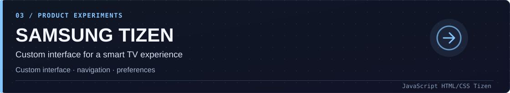

<!-- GitHub Profile · Janaina Arque · V4 draft, not yet published -->

  

  <a href="./README.md">🇧🇷 Ler em português</a> &nbsp;·&nbsp; <strong>🇺🇸 English</strong>

  <a href="https://github.com/janainarque/passa-desafio">Featured project — Passa</a> &nbsp;·&nbsp;
  <a href="mailto:janainarque@gmail.com">Contact</a>

### About me

I'm a **Systems Analyst with over 10 years of software development experience**. I specialize in **PHP and backend engineering**, working on business-critical systems, integrations, APIs, and complex business rules.

I also work across the **full stack** and am currently studying **Applied AI Engineering**, with a growing focus on **intelligent agents, LLMs, and automation**. I care about building software that is reliable, testable, and maintainable.

### Expertise

| Area | Technologies and practices |
| :--- | :--- |
| **Backend** | PHP · Laravel · CodeIgniter · REST APIs · systems integration |
| **Data** | SQL Server · PostgreSQL · transactions · data consistency |
| **Full stack** | JavaScript · Blade · Livewire · Filament · HTML/CSS |
| **Quality & delivery** | Git · automated testing · Docker · CI/CD *(currently deepening)* |
| **Applied AI** | Python · data pipelines · statistics · LangGraph *(learning projects)* |
| **Currently exploring** | AI agents · LLMs · RAG · MCP · evaluation and observability |

### Selected projects

A demonstration platform for prepaid corporate cards featuring **authorization, capture, cancellation, balance control, concurrency, idempotency, and audit trails**.

**[Explore Passa's code and tests](https://github.com/janainarque/passa-desafio)** · `PHP 8.4` `Laravel 13` `PostgreSQL` `Pest`

Based on a public coding challenge/template; attribution is documented in the repository.

A learning project combining a **Bronze/Silver/Gold data pipeline, ELO ratings, Poisson modeling, Monte Carlo simulations, and LangGraph tool orchestration**. Calculations are performed in code; the agent helps query and interpret results.

Under review before publication: credentials, code, documentation, and course attribution. A repository link will be added when ready.

An experimental custom Smart TV interface focused on **navigation, preferences, and user experience**.

**[Explore the Samsung Tizen repository](https://github.com/janainarque/samsung-tv-tizen)** · `JavaScript` `HTML/CSS` `Tizen`

### Applied AI & intelligent agents

I'm exploring the intersection of **software engineering, data, and applied AI**. I have experimented with LangGraph tool orchestration in IAPredict and continue learning about **LLMs, agents, RAG, MCP, evaluation, and safety**.

**Education:** postgraduate studies in Applied AI Engineering *(in progress)*.

### GitHub contributions

  <picture>
    <source media="(prefers-color-scheme: dark)" srcset="https://raw.githubusercontent.com/janainarque/janainarque/output/pacman-contribution-graph-dark.svg" />
    <source media="(prefers-color-scheme: light)" srcset="https://raw.githubusercontent.com/janainarque/janainarque/output/pacman-contribution-graph.svg" />
    
  </picture>

Pac-Man SVGs already exist in the <code>output</code> branch. The workflow must remain enabled to keep them updated.

---

<i>“Reliable software is not just what works. It's what stays correct when the unexpected happens.”</i>

<a href="https://github.com/janainarque">GitHub</a> · <a href="mailto:janainarque@gmail.com">Email</a>

