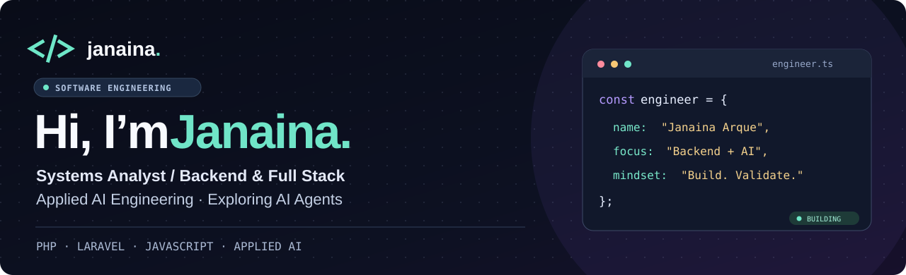
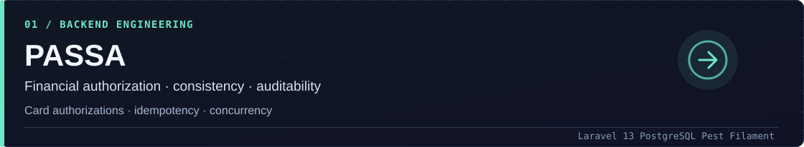
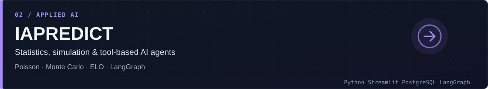

  

  <a href="./README.md">🇧🇷 Ler em português</a> &nbsp;·&nbsp; <strong>🇺🇸 English</strong>

  <a href="https://github.com/janainarque/passa-desafio">Featured project — Passa</a> &nbsp;·&nbsp;
  <a href="mailto:janainarque@gmail.com">Contact</a>

### 01 / About me

I'm a **Systems Analyst with over 10 years of software development experience**. My career has focused on evolving enterprise systems, implementing business rules, integrations, APIs, and solutions that must remain reliable over time.

My main specialty is **PHP backend development**, including **CodeIgniter, Laravel, SQL Server, and PostgreSQL**, along with **JavaScript and full-stack development**. I value readable code, data consistency, testing, traceability, and technical decisions grounded in the product's context.

I'm currently pursuing postgraduate studies in **Applied AI Engineering**, expanding my skills in **intelligent agents, LLMs, and process automation** while building on my practical software engineering background.

### 02 / Stack & expertise

| Area | Technologies and practices |
| :--- | :--- |
| **Backend & integrations** | PHP · Laravel · CodeIgniter · REST APIs · business rules |
| **Data & consistency** | SQL Server · PostgreSQL · SQL · relational modeling · transactions |
| **Full stack** | JavaScript · HTML/CSS · Blade · Livewire · Filament · Tailwind CSS |
| **Quality & collaboration** | Git · GitHub · code review · automated tests · documentation |
| **Environment & delivery** | Docker · Docker Compose · CI/CD *(currently deepening)* |
| **Applied AI** | Python · data pipelines · statistical models · LangGraph *(experiments)* |
| **Currently exploring** | LLM applications · AI Agents · RAG · MCP · AI evaluation and observability |

### 03 / Engineering in practice

<table>
<tr>
<td width="50%" valign="top"><b>Concurrency & integrity</b> Transactions and locks for simultaneous financial operations.</td>
<td width="50%" valign="top"><b>Idempotency</b> Preventing duplicate processing of requests and events.</td>
</tr>
<tr>
<td valign="top"><b>Out-of-order events</b> Handling repeated messages and reconciling states.</td>
<td valign="top"><b>Testability & auditability</b> Edge cases, automated tests, and traceability of operations.</td>
</tr>
</table>

### 04 / Selected projects

A demonstration platform for prepaid corporate cards featuring **authorization, capture, cancellation, balance control, concurrency, idempotency, and audit trails**.

**[Explore Passa's code and tests](https://github.com/janainarque/passa-desafio)** · `PHP 8.4` `Laravel 13` `PostgreSQL` `Pest`

A learning project combining a **Bronze/Silver/Gold data pipeline, ELO ratings, Poisson modeling, Monte Carlo simulations, and LangGraph tool orchestration**. Calculations are performed in code; the agent helps query and interpret results.

An experimental custom Smart TV interface focused on **navigation, preferences, and user experience**.

**[Explore the Samsung Tizen repository](https://github.com/janainarque/samsung-tv-tizen)** · `JavaScript` `HTML/CSS` `Tizen`

### 05 / Applied AI & intelligent agents

I'm exploring the intersection of **software engineering, data, and applied AI**. I have experimented with LangGraph tool orchestration in IAPredict and continue learning about **LLMs, agents, RAG, MCP, evaluation, and safety**.

**Education:** postgraduate studies in Applied AI Engineering *(in progress)*.

### 06 / GitHub contributions

---

<i>“If you truly commit yourself, you can do it.”</i>

— Malsky

<a href="https://github.com/janainarque">GitHub</a> · <a href="mailto:janainarque@gmail.com">Email</a>

