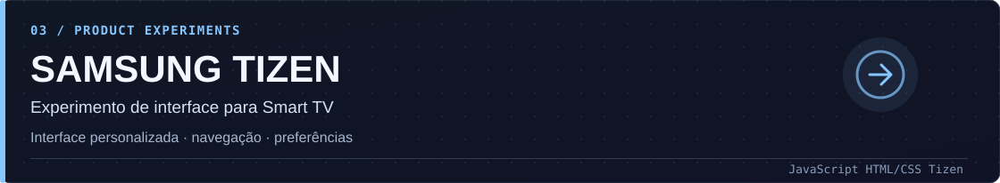

<!-- Perfil GitHub · Janaina Arque · Versão V4 (prévia, ainda não publicada) -->

  

  <strong>🇧🇷 Português</strong> &nbsp;·&nbsp; <a href="./README.en.md">🇺🇸 Read in English</a>

  <a href="https://github.com/janainarque/passa-desafio">Passa — projeto em destaque</a> &nbsp;·&nbsp;
  <a href="mailto:janainarque@gmail.com">Contato</a>

### Sobre mim

Sou **Analista de Sistemas**, com **mais de 10 anos de experiência em desenvolvimento de software**. Trabalho principalmente com **PHP e backend**, evoluindo sistemas corporativos, integrações, APIs e regras de negócio que exigem confiabilidade.

Também atuo com desenvolvimento **full stack** e estou ampliando minha formação em **Engenharia de IA Aplicada**, com interesse em **agentes inteligentes, LLMs e automação**. Gosto de soluções que sejam úteis, testáveis e sustentáveis — não apenas de demonstrações que funcionam uma vez.

### Especialidades

| Área | Tecnologias e práticas |
| :--- | :--- |
| **Backend** | PHP · Laravel · CodeIgniter · APIs REST · integração de sistemas |
| **Dados** | SQL Server · PostgreSQL · transações · consistência |
| **Full stack** | JavaScript · Blade · Livewire · Filament · HTML/CSS |
| **Qualidade & entrega** | Git · testes automatizados · Docker · CI/CD *(em aprofundamento)* |
| **IA aplicada** | Python · pipelines de dados · estatística · LangGraph *(em projetos de estudo)* |
| **Em desenvolvimento** | Agentes de IA · LLMs · RAG · MCP · avaliação e observabilidade |

### Projetos selecionados

Plataforma demonstrativa de cartões corporativos pré-pagos, com **autorização, captura, cancelamento, controle de saldo, concorrência, idempotência e trilha auditável**.

**[Ver código e testes do Passa](https://github.com/janainarque/passa-desafio)** · `PHP 8.4` `Laravel 13` `PostgreSQL` `Pest`

Projeto baseado em desafio/template público, com atribuições no repositório.

Projeto de estudo que combina **pipeline de dados Bronze/Silver/Gold, ELO, Poisson, Monte Carlo e ferramentas orquestradas com LangGraph**. Os cálculos são realizados em código; o agente auxilia na consulta e interpretação.

Em revisão para publicação: código, credenciais, documentação e créditos da imersão. Link será adicionado quando o repositório estiver pronto.

Experimento de personalização da experiência em Smart TV, com foco em **interface, navegação e preferências**.

**[Ver repositório Samsung Tizen](https://github.com/janainarque/samsung-tv-tizen)** · `JavaScript` `HTML/CSS` `Tizen`

### Engenharia de IA & agentes

Minha direção atual é aproximar **engenharia de software, dados e IA aplicada**. Já exploro orquestração de ferramentas com LangGraph no IAPredict e sigo estudando **LLMs, agentes, RAG, MCP, avaliação e segurança**.

**Formação:** pós-graduação em Engenharia de IA Aplicada *(em andamento)*.

### Contribuições

  <picture>
    <source media="(prefers-color-scheme: dark)" srcset="https://raw.githubusercontent.com/janainarque/janainarque/output/pacman-contribution-graph-dark.svg" />
    <source media="(prefers-color-scheme: light)" srcset="https://raw.githubusercontent.com/janainarque/janainarque/output/pacman-contribution-graph.svg" />
    
  </picture>

As imagens do Pac-Man já existem na branch <code>output</code>. Para continuar atualizando, o workflow precisa permanecer ativo.

---

<i>“Software confiável não é apenas o que funciona. É o que continua correto quando o inesperado acontece.”</i>

<a href="https://github.com/janainarque">GitHub</a> · <a href="mailto:janainarque@gmail.com">E-mail</a>

