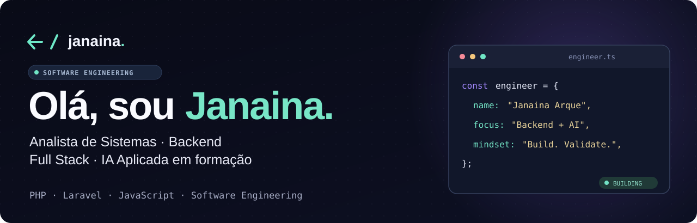

<!-- GitHub Profile · Janaina Arque · github.com/janainarque -->

  

  
  

### 01 / Sobre mim

Sou **Analista de Sistemas**, com **mais de 10 anos de experiência em desenvolvimento de software**. Minha trajetória é marcada pela evolução de sistemas corporativos, implementação de regras de negócio, integrações, APIs e soluções que precisam continuar confiáveis ao longo do tempo.

Minha principal especialidade é **backend com PHP**, incluindo **CodeIgniter, Laravel, SQL Server e PostgreSQL**, com atuação também em **JavaScript e desenvolvimento full stack**. Valorizo código compreensível, consistência de dados, testes, rastreabilidade e decisões técnicas alinhadas ao contexto do produto.

Atualmente, curso **Engenharia de IA Aplicada** e amplio minha atuação para **agentes inteligentes, LLMs e automação de processos**, conectando novos recursos de IA à base de Engenharia de Software que construí na prática.

> Construir uma funcionalidade é só o começo. Entender o domínio, antecipar falhas e manter o sistema confiável é parte essencial da engenharia.

### 02 / Stack & especialidades

| Área | Tecnologias e práticas |
| :--- | :--- |
| **Backend & integrações** | PHP · Laravel · CodeIgniter · APIs REST · regras de negócio |
| **Dados & consistência** | SQL Server · PostgreSQL · SQL · modelagem relacional · transações |
| **Full stack** | JavaScript · HTML/CSS · Blade · Livewire · Filament · Tailwind CSS |
| **Qualidade & colaboração** | Git · GitHub · revisão de código · testes automatizados · documentação |
| **Ambiente & entrega** | Docker · Docker Compose · CI/CD *(em aprofundamento)* |
| **IA aplicada** | Python · pipelines de dados · modelos estatísticos · LangGraph *(experimentos)* |
| **Em desenvolvimento** | LLM applications · AI Agents · RAG · MCP · avaliação e observabilidade de IA |

Distingo as tecnologias utilizadas em projetos daquelas que estou estudando ou aprofundando.

### 03 / Engenharia na prática

<table>
<tr>
<td width="50%" valign="top"><b>Concorrência & integridade</b> Transações e bloqueios para operações financeiras simultâneas.</td>
<td width="50%" valign="top"><b>Idempotência</b> Prevenção de duplicidade no processamento de requisições e eventos.</td>
</tr>
<tr>
<td valign="top"><b>Eventos fora de ordem</b> Tratamento de mensagens repetidas e reconciliação de estados.</td>
<td valign="top"><b>Testabilidade & auditoria</b> Cenários de borda, testes automatizados e rastreabilidade de operações.</td>
</tr>
</table>

Exemplos demonstrados no projeto Passa, não afirmações sobre código corporativo confidencial.

### 04 / Projetos selecionados

#### Passa · Autorização e controle financeiro

**PHP 8.4 · Laravel 13 · PostgreSQL · Filament · Livewire · Pest**

Plataforma demonstrativa para cartões corporativos pré-pagos. Explora **autorizações, capturas, cancelamentos, controle de saldo, limites por cartão, idempotência, concorrência e eventos fora de ordem**, com trilha auditável de movimentações.

**[Explorar código, testes e decisões de arquitetura →](https://github.com/janainarque/passa-desafio)**

Projeto demonstrativo desenvolvido a partir de um desafio/template público, com atribuições documentadas no repositório.

#### IAPredict · Machine Learning + agentes de IA

**Python · pandas · PostgreSQL · Streamlit · LangChain · LangGraph**

Projeto de estudo que combina **pipeline Bronze → Silver → Gold**, classificação por **ELO**, modelagem de gols com **Poisson**, simulações **Monte Carlo** e um **agente com ferramentas** para consultar resultados calculados e produzir explicações.

**Decisão técnica:** as probabilidades são calculadas por código; o modelo de linguagem é usado para orquestração e interpretação, não como fonte de números inventados.

Em revisão para publicação. O código, a documentação, as dependências e as credenciais estão passando por ajustes. Projeto originado de uma imersão, com referências e créditos a preservar. Não há repositório público vinculado por enquanto.

#### Samsung TV Tizen · Interface e experiência de uso

**JavaScript · HTML/CSS · Tizen**

Projeto experimental de personalização da experiência em Smart TV Samsung, envolvendo interface, navegação, preferências e desenvolvimento para o ecossistema Tizen.

**[Explorar repositório →](https://github.com/janainarque/samsung-tv-tizen)**

**Experiência corporativa:** também atuo na manutenção e evolução de sistemas empresariais, integrações e fluxos de negócio. Por confidencialidade, não publico código nem dados internos dessas aplicações.

### 05 / Applied AI & Intelligent Agents

Minha direção de desenvolvimento é integrar **Engenharia de Software, dados e IA** para construir soluções úteis, verificáveis e sustentáveis.

- **Prática atual:** experimentos com Python, modelos estatísticos, pipelines de dados e orquestração de ferramentas com LangGraph no IAPredict.
- **Em estudo e evolução:** aplicações com LLMs, agentes de IA, RAG, MCP, avaliação, segurança e observabilidade.
- **Formação:** pós-graduação em **Engenharia de IA Aplicada** *(em andamento)*.

O foco não é apenas conectar um modelo de linguagem a uma interface, mas pensar em **arquitetura, integração, qualidade e limites operacionais** para aplicações inteligentes.

### 06 / Atividade no GitHub

  <picture>
    <source media="(prefers-color-scheme: dark)" srcset="https://raw.githubusercontent.com/janainarque/janainarque/output/pacman-contribution-graph-dark.svg" />
    <source media="(prefers-color-scheme: light)" srcset="https://raw.githubusercontent.com/janainarque/janainarque/output/pacman-contribution-graph.svg" />
    
  </picture>

O gráfico é gerado pelo GitHub Actions e aparecerá após a primeira execução bem-sucedida do workflow incluído neste pacote.

---

<i>“Software confiável não é apenas o que funciona. É o que continua correto quando o inesperado acontece.”</i>

<a href="https://github.com/janainarque">GitHub</a> · <a href="mailto:janainarque@gmail.com">E-mail</a>
