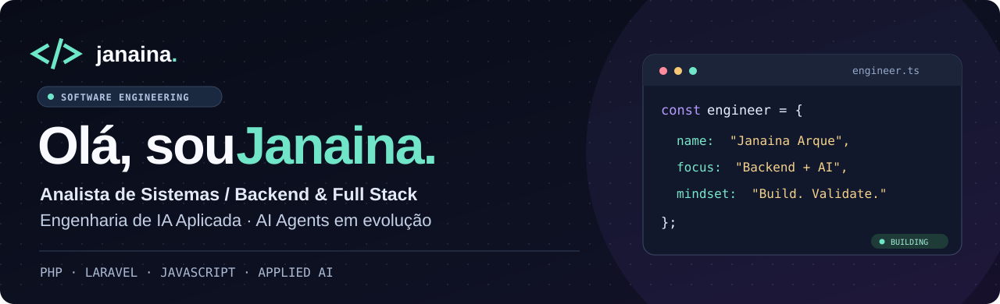
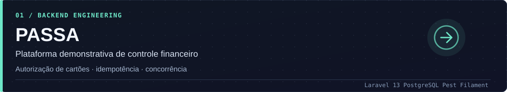
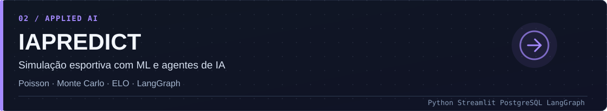

  

  <strong>🇧🇷 Português</strong> &nbsp;·&nbsp; <a href="./README.en.md">🇺🇸 Read in English</a>

  <a href="https://github.com/janainarque/passa-desafio">Passa — projeto em destaque</a> &nbsp;·&nbsp;
  <a href="mailto:janainarque@gmail.com">Contato</a>

### 01 / Sobre mim

Sou **Analista de Sistemas**, com **mais de 10 anos de experiência em desenvolvimento de software**. Minha trajetória é marcada pela evolução de sistemas corporativos, implementação de regras de negócio, integrações, APIs e soluções que precisam continuar confiáveis ao longo do tempo.

Minha principal especialidade é **backend com PHP**, incluindo **CodeIgniter, Laravel, SQL Server e PostgreSQL**, com atuação também em **JavaScript e desenvolvimento full stack**. Valorizo código compreensível, consistência de dados, testes, rastreabilidade e decisões técnicas alinhadas ao contexto do produto.

Atualmente, curso **Engenharia de IA Aplicada** e amplio minha atuação para **agentes inteligentes, LLMs e automação de processos**, conectando novos recursos de IA à base de Engenharia de Software que construí na prática.

### 02 / Stack & especialidades

| Área | Tecnologias e práticas |
| :--- | :--- |
| **Backend & integrações** | PHP · Laravel · CodeIgniter · APIs REST · regras de negócio |
| **Dados & consistência** | SQL Server · PostgreSQL · SQL · modelagem relacional · transações |
| **Full stack** | JavaScript · HTML/CSS · Blade · Livewire · Filament · Tailwind CSS |
| **Qualidade & colaboração** | Git · GitHub · revisão de código · testes automatizados · documentação |
| **Ambiente & entrega** | Docker · Docker Compose · CI/CD *(em aprofundamento)* |
| **IA aplicada** | Python · pipelines de dados · modelos estatísticos · LangGraph *(experimentos)* |
| **Em desenvolvimento** | LLM applications · AI Agents · RAG · MCP · avaliação e observabilidade de IA |

### 03 / Engenharia na prática

<table>
<tr>
<td width="50%" valign="top"><b>Concorrência & integridade</b> Transações e bloqueios para operações financeiras simultâneas.</td>
<td width="50%" valign="top"><b>Idempotência</b> Prevenção de duplicidade no processamento de requisições e eventos.</td>
</tr>
<tr>
<td valign="top"><b>Eventos fora de ordem</b> Tratamento de mensagens repetidas e reconciliação de estados.</td>
<td valign="top"><b>Testabilidade & auditoria</b> Cenários de borda, testes automatizados e rastreabilidade de operações.</td>
</tr>
</table>

### 04 / Projetos selecionados

Plataforma demonstrativa de cartões corporativos pré-pagos, com **autorização, captura, cancelamento, controle de saldo, concorrência, idempotência e trilha auditável**.

**[Ver código e testes do Passa](https://github.com/janainarque/passa-desafio)** · `PHP 8.4` `Laravel 13` `PostgreSQL` `Pest`

Projeto de estudo que combina **pipeline de dados Bronze/Silver/Gold, ELO, Poisson, Monte Carlo e ferramentas orquestradas com LangGraph**. Os cálculos são realizados em código; o agente auxilia na consulta e interpretação.

Experimento de personalização da experiência em Smart TV, com foco em **interface, navegação e preferências**.

**[Ver repositório Samsung Tizen](https://github.com/janainarque/samsung-tv-tizen)** · `JavaScript` `HTML/CSS` `Tizen`

### 05 / Engenharia de IA & agentes

Minha direção atual é aproximar **engenharia de software, dados e IA aplicada**. Já exploro orquestração de ferramentas com LangGraph no IAPredict e sigo estudando **LLMs, agentes, RAG, MCP, avaliação e segurança**.

**Formação:** pós-graduação em Engenharia de IA Aplicada *(em andamento)*.

### 06 / Contribuições

  <picture>
    <source media="(prefers-color-scheme: dark)" srcset="https://raw.githubusercontent.com/janainarque/janainarque/output/pacman-contribution-graph-dark.svg" />
    <source media="(prefers-color-scheme: light)" srcset="https://raw.githubusercontent.com/janainarque/janainarque/output/pacman-contribution-graph.svg" />
    
  </picture>

---

<i>“Software confiável não é apenas o que funciona. É o que continua correto quando o inesperado acontece.”</i>

<a href="https://github.com/janainarque">GitHub</a> · <a href="mailto:janainarque@gmail.com">E-mail</a>

